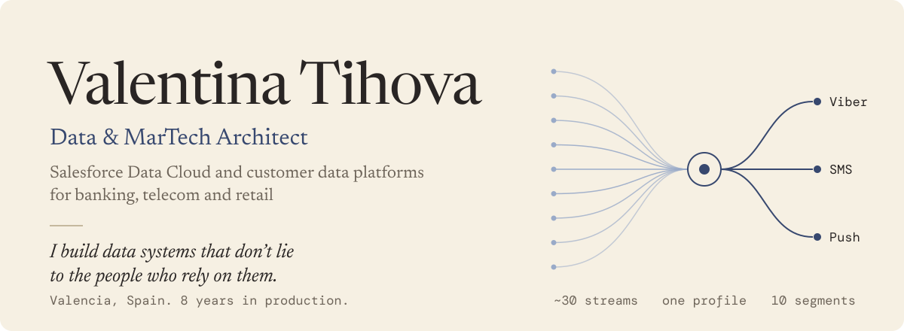

<picture>
  <source media="(prefers-color-scheme: dark)" srcset="assets/header-dark.svg">
  
</picture>

I find where a product's data misleads people, and fix it. Right now that means Salesforce customer data platforms, made legible to data engineers: what the schema is, what changed, and which numbers to trust. Eight years with customer data in banking, telecom and retail; since 2025, Salesforce Data 360 and Marketing Cloud from the data model to production support.

### Open source and products

| Project | What it solves | Status |
|---|---|---|
| **[data360-autodoc](https://github.com/valentinatihova/data360-autodoc)** | Generates a data dictionary, field mappings, an ERD and a JSON snapshot for any Salesforce Data 360 org, and diffs two snapshots so CI fails when the schema drifts. |  MIT |
| **[Suspicious opens in SFMC](https://github.com/valentinatihova/sfmc-false-opens)** | Flags machine-generated email opens using Marketing Cloud Data Views, so engagement reports count people, not security scanners that open mail seconds after delivery. | SQL published, MIT |
| **[SFMC Campaign Ops Analytics](https://github.com/valentinatihova/sfmc-journey-change-log)** | Measures campaign lead time, rework and handoffs from Journey Builder audit logs, as an app inside Marketing Cloud. First module open-sourced: an offline Journey Change Log report that shows who launched what, and what went live without testing. | In discovery · [v0.1.0](https://github.com/valentinatihova/sfmc-journey-change-log/releases/latest) MIT |

### Before that, in production

- **Moved a bank with 30M+ retail customers to a new CDP in six months.** Campaigns, segments and data migrated from a legacy decisioning engine and Oracle to PostgreSQL and Tarantool; five complex flows re-implemented on the new stack.
- **Took a retail bank's Salesforce Data Cloud from an empty org to live activation.** About 30 data streams and DMOs, identity resolution, calculated insights and 10 segments feeding cross-channel journeys.
- **Designed custom Viber, SMS and push channels** between Marketing Cloud and a bank's notification platform, and led the incident response when the callback contract changed, tracing the loss down to individual sends.
- **Built Kafka monitoring for campaign triggers** that detects failures and restarts campaigns automatically.
- **Shipped 15+ real-time decisioning cases**: offer recalculation, card issuance, instalment products and transactional triggers, from brief to production.

### Writing

- [When open rate lies: detecting suspicious opens in SFMC](https://valentinatihova.com/article/sfmc-false-opens) (April 2026). SQL on Data Views and send timing that separates human opens from scanner traffic.

### Toolbox

**Customer data:** Salesforce Data Cloud (Data 360), Marketing Cloud Engagement (Journey Builder, Automation Studio, AMPscript, SSJS), CDP and real-time decisioning engines 
**Engineering:** SQL (Oracle, PostgreSQL), Python, Apex, REST APIs, Kafka, Airflow, Docker, Kubernetes 
**Analytics:** Azure Databricks, Power BI, Tableau

### Contact

[valentinatihova.com](https://valentinatihova.com) · [LinkedIn](https://www.linkedin.com/in/valentina-tihova/) · [valentina.tikhova1@gmail.com](mailto:valentina.tikhova1@gmail.com)
